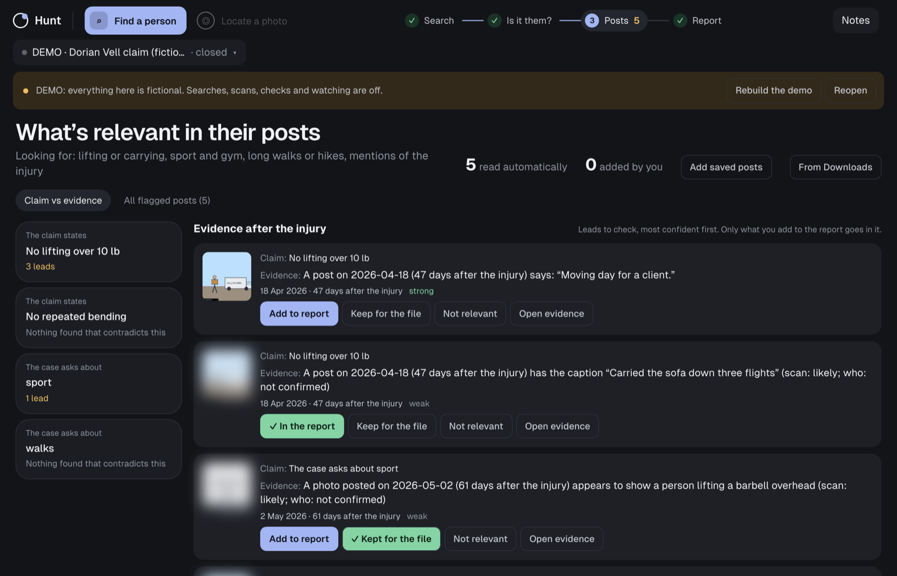
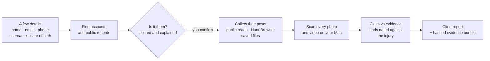
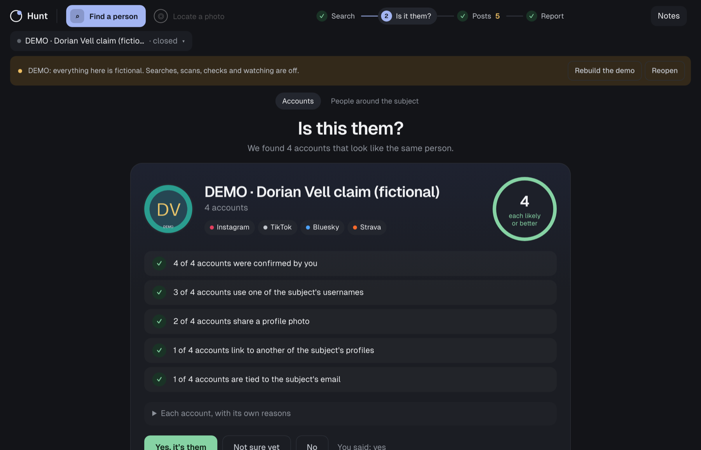
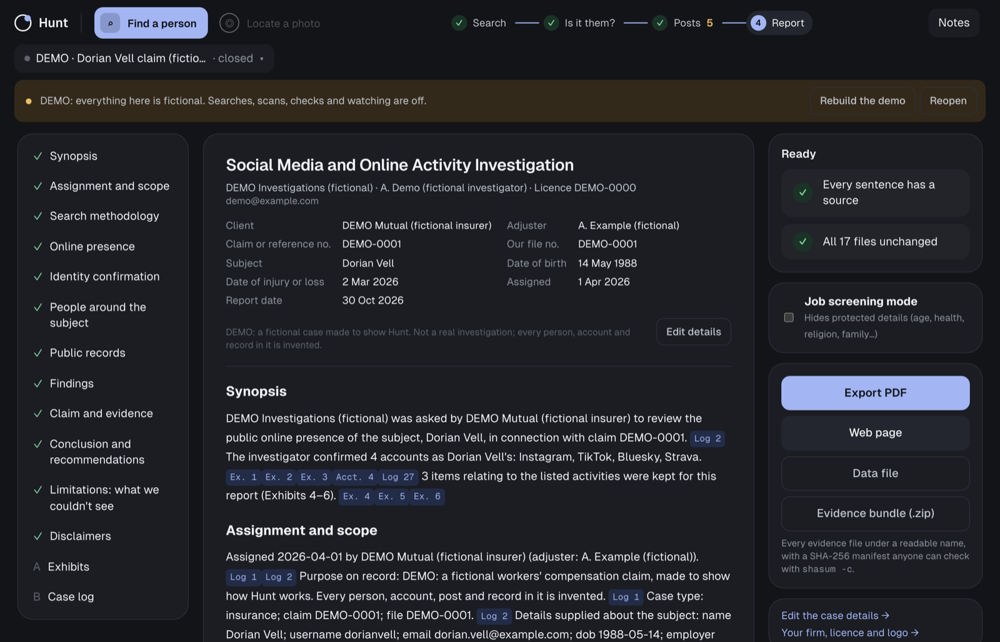

<div align="center">


# Hunt

**One search, every source, the right person, with proof.**

Free, open-source, local-first investigation software for<br>
**background checks · insurance claims · due diligence · social media reports**

[](https://github.com/als7294/hunt/actions/workflows/checks.yml)
[](https://github.com/als7294/hunt/releases)
[](LICENSE)


[**User guide**](docs/user-guide.md) · [**Install**](#install) · [**Try the demo**](#try-the-demo) · [**Guardrails**](#guardrails) · [**For counsel**](docs/for-counsel.md)

<br>



<sub>The fictional demo case: what the claim states, set against what the subject's own posts show, dated against the injury.</sub>

</div>

<br>

Start with whatever you have: a name, username, email, phone number, date of birth, address or profile link. Hunt:

- **finds** the person's accounts and public records,
- **shows** which ones really belong to them, and why,
- **looks through** what they post for what your client needs to know (for example, lifting after an injury date),
- **hands you** a report where every sentence cites its evidence.

Your cases, your evidence and the AI that reads photos and videos stay on your Mac. It's built for investigators who know their trade, not their terminal.

## How it works



| Step | What happens |
|---|---|
| **Find a person** | Checks hundreds of sites and public records at once (federal and many state and county court records, licences, business registries, trucking carriers, race and powerlifting results), and logs every source asked, including the empty ones |
| **Is it them?** | Scores each account against everything the case knows, explains every point, and sets namesakes aside. You decide |
| **Posts** | Reads public posts logged out (Bluesky, Mastodon, TikTok's public pages, YouTube with a free key), takes in what you view in the **Hunt Browser** and the files you saved, and optionally public Instagram and Facebook posts through Apify on your own account. Scans every photo and video on your Mac with a local vision model, dated before or after the injury |
| **Claim vs evidence** | Sets each restriction in the claim ("no lifting over 10 lb") against what the evidence shows, as leads you keep, report or set aside |
| **Report** | Laid out like an insurance or online-activity investigation report and written from the case's records, with no language model. Every sentence is cited; ICD 203 confidence wording; a screening version for employment (FCRA); a hashed evidence bundle anyone can check with `shasum -c` |

<table>
<tr>
<td width="50%"></td>
<td width="50%"></td>
</tr>
<tr>
<td align="center"><sub><b>Is it them?</b> Every account scored, every reason shown.</sub></td>
<td align="center"><sub><b>The report.</b> Every sentence cited; PDF, web page, data file and evidence bundle.</sub></td>
</tr>
</table>

**Everyday helpers**

- **Clean up downloads:** file messy saves (`ssstik.io_1745821072612.mp4`) under clear exhibit names, with the post time read from its ID.
- **Over the life of a claim:** check the subject's accounts again, or watch them on a schedule with local notifications. Deleted posts and accounts going private are logged.
- **Notes** with timestamps you can cite.
- **"Have we seen this person before?"** across your cases.
- **Move a case between Macs** in one encrypted, hash-checked archive.
- **People around the subject:** names and quotes from the subject's own posts, bios and records. Never searched, never contacted, children never named.

More in [docs/qol.md](docs/qol.md).

## Guardrails

Built in, not bolted on. The full list, with the reasoning behind each, is [Hunt's rules](docs/research/legal.md#hunts-rules).

- **A purpose is required for every case,** and every case keeps an audit log of each search, decision, import and export.
- **No software-caused request to a login-walled platform.** On Facebook, Instagram, TikTok, X and LinkedIn you browse as yourself in the Hunt Browser, and Hunt Capture records only what you open. Hunt never logs in and never drives your account.
- **Your own real account only:** no fake accounts, sock puppets or pretexting.
- **The subject and their associates are never contacted or notified:** no following, friending, liking or messaging.
- **No getting around a limit:** no CAPTCHA solving, no proxies, IP rotation or spoofing. Hunt stops at the first refusal, and on any sign a platform has revoked access.
- **No face search.** An opt-in one-to-one check against your own reference photo, only where the subject's home is a place it recognises and doesn't block.
- **Machine verdicts stop at "likely";** only your review goes further.
- **Employment screening mode** drops protected traits, sensitive records and relationships; background checks always get it.
- **Children** are never named, and media where a child may be visible is blurred in the app and the report.
- **Retention is a reminder:** at 90 days Hunt asks you to delete, hold or trim the case. Deleting moves files to the Trash.

If you furnish reports for employment, tenancy, credit or insurance decisions, you are likely a consumer reporting agency under the FCRA, whatever software you use. Hunt helps you comply; it doesn't exempt you. It **complements** licensed data-broker tools (TLOxp, Accurint and the like) rather than replacing them. Why each line is where it is: [legal.md](docs/research/legal.md) and [automation-legal.md](docs/research/automation-legal.md).

## Install

You need a Mac with Apple Silicon and about 6 GB free. In Terminal, once:

```bash
brew install uv
```

```bash
uv tool install --python 3.12 git+https://github.com/als7294/hunt && hunt setup
```

`hunt setup` puts **Hunt** in Applications, shows the size of each download (the browser, about 0.2 GB; the vision model, 3.3 GB) and asks before fetching it. Then install [Ollama](https://ollama.com/download), which runs the vision model, and open it once. Double-click **Hunt** to start.

On first run Hunt checks itself, asks you to sign in to the platforms you use in the Hunt Browser, and offers optional free keys (GitHub, Gravatar, OpenFEC, CourtListener, state open-data portals) that unlock more from some sources. Hunt runs completely free without any of them.

| Command | Does |
|---|---|
| `hunt doctor` | Checks everything Hunt needs, with plain fixes |
| `hunt update` | Updates Hunt |
| `hunt uninstall` | Removes Hunt (asks before moving your cases to the Trash) |

No `brew`? See [uv's installation page](https://docs.astral.sh/uv/getting-started/installation/). From source:

```bash
git clone https://github.com/als7294/hunt && cd hunt && uv sync && uv run hunt setup
```

### Try the demo

```bash
hunt demo
```

Adds a finished, fully fictional investigation, marked DEMO everywhere, so you can click through every step before running a real case. The first-run screen offers it too.

## How matching works

Every hit is scored against everything the case knows, Fellegi–Sunter style. Each signal adds or subtracts bits, and the total maps to an [ICD 203](https://www.dni.gov/files/documents/ICD/ICD-203.pdf) verdict, from "almost no chance" to "almost certain".

| Signal | How it's judged |
|---|---|
| Username | Rarity is measured, not guessed: "taken on 469 of 788 sites checked" means common |
| Name | Nickname-aware (Bob ↔ Robert); graded match, similar, part of, or conflicts |
| Location | Geocoded and compared by distance: same area, region or country, or a conflict |
| Date of birth, age, employer | Checked against what records show, to tell namesakes apart |
| Email | A Gravatar hash or listed email matching the subject's is near-conclusive |
| Links | Links to the subject's known profiles count; links back to the same site don't |
| Profile photo | The same picture on a likely match, or matching a photo in the case, is a second identifier |

## Status

**0.1.0, the first release.** [CHANGELOG.md](CHANGELOG.md) lists what it does and what isn't built yet. Coming next: the reference-photo screen for the face check, and **Locate a photo** (photo geolocation, built and benchmarked, on hold). See the [roadmap](docs/roadmap.md).

## Docs

| Doc | What's in it |
|---|---|
| [user-guide.md](docs/user-guide.md) | For investigators: install, first run, a case from start to report, verdicts, handing over evidence |
| [CHANGELOG.md](CHANGELOG.md) | What each release does, and what isn't built yet |
| [qol.md](docs/qol.md) | Everyday helpers: downloads, evidence bundle, Check again, watching, notes, moving cases, seen before, setup |
| [capture.md](docs/capture.md) | The Hunt Browser and Hunt Capture |
| [analysis.md](docs/analysis.md) | Identity scoring, people around the subject, claim vs evidence |
| [api.md](docs/api.md) | The local app's API |
| [for-counsel.md](docs/for-counsel.md) | Two pages for a lawyer: what Hunt does and doesn't do, and the open questions |
| [research/legal.md](docs/research/legal.md) | FCRA, DPPA/GLBA, scraping case law, biometrics, human-driven capture, and Hunt's rules |
| [research/automation-legal.md](docs/research/automation-legal.md) | How far collection from Facebook, Instagram and TikTok can lawfully be automated |
| [research/compliance-audit.md](docs/research/compliance-audit.md) | The code checked against every rule |
| [research/report-format.md](docs/research/report-format.md) | How insurance and online-activity reports are laid out |
| [research/scan-eval.md](docs/research/scan-eval.md) | How accurate and fast the media scan is, on a held-out test set |
| [research/tools.md](docs/research/tools.md) | Sources, open-source tools and free APIs, with terms and limits |
| [SECURITY.md](SECURITY.md) | The threat model, and how to report a problem |

**Self-checks** (offline, fictional subjects only; CI runs them on every push):

```bash
for t in test_*.py; do uv run python "$t"; done
```

## Credits

Hunt is made by **Laura G** and **SmittyTech**.

It builds on [Maigret](https://github.com/soxoj/maigret), [WhatsMyName](https://github.com/WebBreacher/WhatsMyName) (CC BY-SA 4.0), [user-scanner](https://github.com/kaifcodec/user-scanner), [yt-dlp](https://github.com/yt-dlp/yt-dlp), [OpenPowerlifting](https://www.openpowerlifting.org/), [GeoCLIP](https://github.com/VicenteVivan/geo-clip) and others listed in [tools.md](docs/research/tools.md).

## Licence

[AGPL-3.0](LICENSE).
